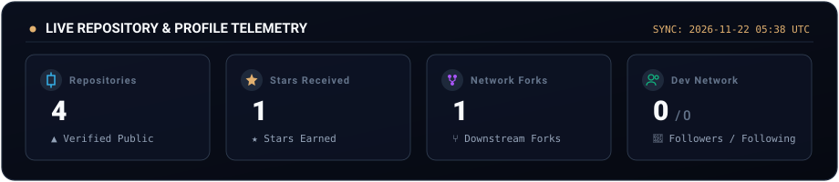

<div align="center">

<!-- ═══════════════════════════════════════════════════════════════════ -->
<!-- 1. CLASSY HERO BANNER & DEVELOPER IDENTITY                         -->
<!-- ═══════════════════════════════════════════════════════════════════ -->

<a href="https://github.com/Param198-sharma">
  
</a>

<br/>

<!-- Dynamic Typing Animation with Classy Champagne Gold & Sapphire -->
<a href="https://github.com/Param198-sharma">
  
</a>

<br/>

<!-- Classy Telemetry Badges -->
<p align="center">
  
  
  
</p>

<!-- Social & Communication Links -->
<p align="center">
  <a href="https://github.com/Param198-sharma?tab=repositories" target="_blank">
    
  </a>
  <a href="mailto:pritamsharma@example.com" target="_blank">
    
  </a>
  <a href="https://linkedin.com/in/" target="_blank">
    
  </a>
  <a href="https://leetcode.com/" target="_blank">
    
  </a>
</p>


</div>

<!-- ═══════════════════════════════════════════════════════════════════ -->
<!-- 2. ABOUT ME & CURRENT LEARNING FOCUS                              -->
<!-- ═══════════════════════════════════════════════════════════════════ -->

### 🧭 About Me // Journey & Core Focus

```bash
$ info --profile
```

<table>
  <tr>
    <td width="65%" valign="top">
      <p>
        Hi, I'm <strong>Pritam Sharma</strong> — an <strong>Aspiring Software Developer</strong> driven by a passion for clean code, solid problem solving, and building intuitive user experiences.
      </p>
      <ul>
        <li>🧠 <strong>Data Structures & Algorithms:</strong> Grinding core algorithmic problem solving, time/space complexity optimization, recursion, graphs, dynamic programming, and data modeling.</li>
        <li>🎨 <strong>Frontend Craftsmanship:</strong> Mastering responsive UI engineering, state management, modern component design, and engaging frontend experiences.</li>
        <li>🤖 <strong>Artificial Intelligence & ML:</strong> Exploring intelligent agents, neural networks, machine learning fundamentals, and AI integration into practical software.</li>
        <li>🌱 <strong>Software Engineering Principles:</strong> Committed to clean architecture, writing maintainable code, test-driven logic, and continuous self-improvement.</li>
        <li>📫 <strong>Let's Connect:</strong> Eager to collaborate on open-source projects, DSA practice groups, and innovative software builds!</li>
      </ul>
    </td>
    <td width="35%" valign="top" align="center">
      <br/>
      
    </td>
  </tr>
</table>

<div align="center">
  
</div>

<!-- ═══════════════════════════════════════════════════════════════════ -->
<!-- 3. LIVE GITHUB STATISTICS DASHBOARD                                -->
<!-- ═══════════════════════════════════════════════════════════════════ -->

### 📊 Live GitHub Statistics & Telemetry

<div align="center">
  
</div>

<br/>

<div align="center">
  <table>
    <tr>
      <td width="50%" align="center">
        <a href="https://github.com/Param198-sharma">
          
        </a>
      </td>
      <td width="50%" align="center">
        <a href="https://github.com/Param198-sharma">
          
        </a>
      </td>
    </tr>
  </table>
</div>

<div align="center">
  
</div>

<!-- ═══════════════════════════════════════════════════════════════════ -->
<!-- 4. CONTRIBUTION HEATMAP & ACTIVITY CADENCE                         -->
<!-- ═══════════════════════════════════════════════════════════════════ -->

### 📅 Contribution Heatmap & Coding Consistency

<div align="center">
  
</div>

<div align="center">
  
</div>

<!-- ═══════════════════════════════════════════════════════════════════ -->
<!-- 5. GITHUB TROPHIES & ACHIEVEMENTS                                 -->
<!-- ═══════════════════════════════════════════════════════════════════ -->

### 🏆 GitHub Milestones & Trophies

<div align="center">
  <a href="https://github.com/Param198-sharma">
    
  </a>
</div>

<div align="center">
  
</div>

<!-- ═══════════════════════════════════════════════════════════════════ -->
<!-- 6. PROGRAMMING LANGUAGE ANALYTICS                                  -->
<!-- ═══════════════════════════════════════════════════════════════════ -->

### 📈 Codebase Language Distribution

<div align="center">
  
</div>

<div align="center">
  
</div>

<!-- ═══════════════════════════════════════════════════════════════════ -->
<!-- 7. TECHNOLOGY STACK & LEARNING TRACK                               -->
<!-- ═══════════════════════════════════════════════════════════════════ -->

### 🛠️ Tech Stack & Active Learning Curriculum

<div align="center">

| Domain | Technologies & Frameworks |
| :--- | :--- |
| **Problem Solving & Core** |      |
| **Frontend Development** |      |
| **AI & Machine Learning** |      |
| **Tools & Version Control** |     |

</div>

<div align="center">
  
</div>

<!-- ═══════════════════════════════════════════════════════════════════ -->
<!-- 8. ACTIVE ROADMAP & GROWTH PATH                                    -->
<!-- ═══════════════════════════════════════════════════════════════════ -->

### 🎯 Active Growth Path & Learning Roadmap

<div align="center">

```
  ┌─────────────────────────┐      ┌─────────────────────────┐      ┌─────────────────────────┐
  │ DSA & Problem Solving   │ ───► │ Frontend Craftsmanship  │ ───► │ Applied AI & ML         │
  │ Arrays, Trees, Graphs   │      │ Modern React & UI Logic │      │ Models & Intelligent App│
  └─────────────────────────┘      └─────────────────────────┘      └─────────────────────────┘
```

</div>

- 🧩 **DSA Mastery:** Practicing daily algorithmic puzzles on LeetCode & Codeforces to build strong analytical instincts.
- 💻 **Frontend Engineering:** Sharpening component architecture, performance optimization, and responsive design systems.
- 🤖 **AI / ML Foundations:** Exploring supervised/unsupervised learning models, dataset pipelines, and modern AI frameworks.
- 🚀 **Software Development:** Writing clean, testable, and maintainable software to prepare for high-impact engineering roles.

<div align="center">
  
</div>

<!-- ═══════════════════════════════════════════════════════════════════ -->
<!-- 9. CONNECT WITH ME                                                 -->
<!-- ═══════════════════════════════════════════════════════════════════ -->

### 🤝 Connect & Collaborate

<div align="center">
  <p>I am always excited to discuss algorithms, software engineering, frontend tips, or machine learning ideas. Feel free to reach out:</p>
  
  <p>
    <a href="https://github.com/Param198-sharma">
      
    </a>
    <a href="https://linkedin.com/in/">
      
    </a>
    <a href="mailto:pritamsharma@example.com">
      
    </a>
  </p>
  
  <br/>

  <sub>Curated with a classy dark palette • Continuously updated via GitHub Actions</sub>

  <br/><br/>

  <a href="#-about-me--journey--core-focus">
    
  </a>
</div>
