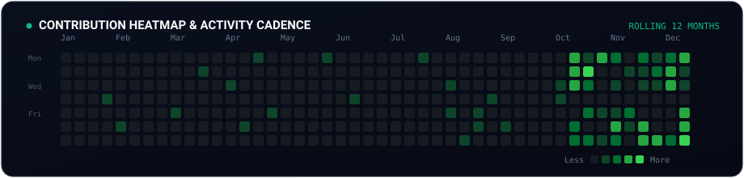
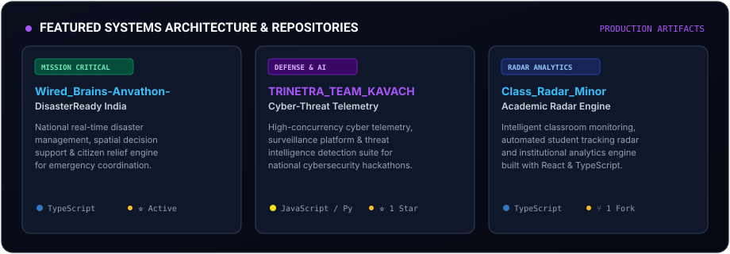
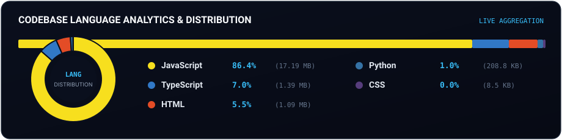

<div align="center">

<!-- ═══════════════════════════════════════════════════════════════════ -->
<!-- 1. ANIMATED HERO BANNER                                            -->
<!-- ═══════════════════════════════════════════════════════════════════ -->

<a href="https://github.com/Param198-sharma">
  
</a>

<br/>

<!-- Dynamic Typing Header Sub-Bar -->
<a href="https://github.com/Param198-sharma">
  
</a>

<br/>

<!-- Visitor Counter & Quick Stats Badges -->
<p align="center">
  
  
  
</p>

<!-- Social & Professional Telemetry Links -->
<p align="center">
  <a href="https://github.com/Param198-sharma?tab=repositories" target="_blank">
    
  </a>
  <a href="mailto:pritamsharma@example.com" target="_blank">
    
  </a>
  <a href="https://linkedin.com/in/" target="_blank">
    
  </a>
  <a href="https://github.com/Param198-sharma" target="_blank">
    
  </a>
</p>


</div>

<!-- ═══════════════════════════════════════════════════════════════════ -->
<!-- 2. INTRODUCTION & CORE INTELLIGENCE                               -->
<!-- ═══════════════════════════════════════════════════════════════════ -->

### 🛰️ Executive Telemetry // System Profile

```bash
$ identity --inspect Param198-sharma
```

<table>
  <tr>
    <td width="65%" valign="top">
      <p>
        I am <strong>Pritam Sharma</strong>, a Systems Engineer and Full-Stack Architect specialized in constructing resilient, high-concurrency software architectures, national-scale disaster response platforms, and mission-critical cyber defense telemetry systems.
      </p>
      <ul>
        <li>🔭 <strong>Active Engineering:</strong> Architecting national real-time disaster management & spatial decision engines (<em>DisasterReady India</em>).</li>
        <li>🛡️ <strong>Cybersecurity & Defense:</strong> Developing automated vulnerability telemetry & surveillance pipelines (<em>TRINETRA Kavach</em>).</li>
        <li>🔬 <strong>Academic Telemetry:</strong> Engineering smart campus attendance radar suites and performance analytics engines (<em>Class Radar</em>).</li>
        <li>⚡ <strong>Engineering Philosophy:</strong> Zero unnecessary dependencies, resilient fallbacks, modular micro-architectures, and high-throughput real-time telemetry.</li>
        <li>📫 <strong>Direct Transmission:</strong> Available for high-impact software engineering, systems design, and technical collaborations.</li>
      </ul>
    </td>
    <td width="35%" valign="top" align="center">
      <br/>
      
    </td>
  </tr>
</table>

<div align="center">
  
</div>

<!-- ═══════════════════════════════════════════════════════════════════ -->
<!-- 3. LIVE GITHUB STATISTICS & PERFORMANCE DASHBOARD                   -->
<!-- ═══════════════════════════════════════════════════════════════════ -->

### 📊 Live GitHub Statistics & Core Telemetry

<div align="center">
  
</div>

<br/>

<div align="center">
  <table>
    <tr>
      <td width="50%" align="center">
        <a href="https://github.com/Param198-sharma">
          
        </a>
      </td>
      <td width="50%" align="center">
        <a href="https://github.com/Param198-sharma">
          
        </a>
      </td>
    </tr>
  </table>
</div>

<div align="center">
  
</div>

<!-- ═══════════════════════════════════════════════════════════════════ -->
<!-- 4. CONTRIBUTION HEATMAP & CALENDAR CADENCE                         -->
<!-- ═══════════════════════════════════════════════════════════════════ -->

### 📅 Contribution Calendar & Activity Cadence

<div align="center">
  
</div>

<br/>

<div align="center">
  <a href="https://github.com/Param198-sharma">
    
  </a>
</div>

<div align="center">
  
</div>

<!-- ═══════════════════════════════════════════════════════════════════ -->
<!-- 5. GITHUB TROPHIES & MILESTONES                                   -->
<!-- ═══════════════════════════════════════════════════════════════════ -->

### 🏆 Verified GitHub Achievements & Trophies

<div align="center">
  <a href="https://github.com/Param198-sharma">
    
  </a>
</div>

<div align="center">
  
</div>

<!-- ═══════════════════════════════════════════════════════════════════ -->
<!-- 6. FEATURED REPOSITORIES SHOWCASE                                  -->
<!-- ═══════════════════════════════════════════════════════════════════ -->

### 🚀 Production Repositories & System Showcases

<div align="center">
  
</div>

<br/>

<table>
  <thead>
    <tr>
      <th align="left">Repository</th>
      <th align="left">Mission &amp; Scope</th>
      <th align="center">Tech Stack</th>
      <th align="center">Role</th>
      <th align="center">Source</th>
    </tr>
  </thead>
  <tbody>
    <tr>
      <td><strong>🌐 Wired_Brains-Anvathon-</strong></td>
      <td><strong>DisasterReady India (आपदा सचेत भारत)</strong>: National real-time disaster management, automated evacuation routing & spatial decision support engine.</td>
      <td align="center"><code>TypeScript</code> <code>Next.js</code> <code>Docker</code></td>
      <td align="center"><span style="color:#10b981;">Lead Architect</span></td>
      <td align="center"><a href="https://github.com/Param198-sharma/Wired_Brains-Anvathon-"><strong>Inspect ↗</strong></a></td>
    </tr>
    <tr>
      <td><strong>🛡️ TRINETRA_TEAM_KAVACH</strong></td>
      <td><strong>Trinetra Kavach Cyber-Defense</strong>: National defense hackathon platform for automated cyber-telemetry, vulnerability analysis & threat detection.</td>
      <td align="center"><code>JavaScript</code> <code>Python</code> <code>HTML5</code></td>
      <td align="center"><span style="color:#a855f7;">Core Engineer</span></td>
      <td align="center"><a href="https://github.com/Param198-sharma/TRINETRA_TEAM_KAVACH"><strong>Inspect ↗</strong></a></td>
    </tr>
    <tr>
      <td><strong>📡 Class_Radar_Minor_Project</strong></td>
      <td><strong>Class Radar Academic Telemetry</strong>: High-efficiency student attendance tracking, institutional radar suite & performance diagnostics dashboard.</td>
      <td align="center"><code>TypeScript</code> <code>React</code> <code>CSS3</code></td>
      <td align="center"><span style="color:#38bdf8;">Systems Lead</span></td>
      <td align="center"><a href="https://github.com/Param198-sharma/Class_Radar_Minor_Project"><strong>Inspect ↗</strong></a></td>
    </tr>
  </tbody>
</table>

<div align="center">
  
</div>

<!-- ═══════════════════════════════════════════════════════════════════ -->
<!-- 7. PROGRAMMING LANGUAGE ANALYTICS                                  -->
<!-- ═══════════════════════════════════════════════════════════════════ -->

### 📈 Codebase Language Telemetry & Distribution

<div align="center">
  
</div>

<div align="center">
  
</div>

<!-- ═══════════════════════════════════════════════════════════════════ -->
<!-- 8. TECHNOLOGY STACK & TOOLING SUITE                                -->
<!-- ═══════════════════════════════════════════════════════════════════ -->

### 🛠️ Core Technology Stack & Engineering Arsenal

<div align="center">

| Domain | Verified Tooling & Frameworks |
| :--- | :--- |
| **Core Languages** |       |
| **Frontend Ecosystem** |     |
| **Backend & APIs** |     |
| **Databases & Cache** |     |
| **DevOps & Infrastructure** |     |
| **Currently Learning** |    |

</div>

<div align="center">
  
</div>

<!-- ═══════════════════════════════════════════════════════════════════ -->
<!-- 9. CURRENT FOCUS & MILESTONES                                      -->
<!-- ═══════════════════════════════════════════════════════════════════ -->

### 🎯 Current Focus & Active Roadmap

<div align="center">

```
  ┌─────────────────────────┐      ┌─────────────────────────┐      ┌─────────────────────────┐
  │  Real-Time Spatial Ops  │ ───► │ Distributed Cyber Mesh  │ ───► │ Production Cloud CI/CD  │
  │   DisasterReady India   │      │   TRINETRA Telemetry    │      │  Autonomous Telemetry   │
  └─────────────────────────┘      └─────────────────────────┘      └─────────────────────────┘
```

</div>

- 🗺️ **High-Concurrency Spatial Routing:** Refining low-latency geospatial clustering algorithms for regional emergency relief.
- 🔐 **Telemetry Hardening:** Implementing strict access controls, cryptographic validation, and event streaming for telemetry pipelines.
- ⚙️ **Automated Profile Telemetry:** Continuous daily health checks and automated repository sync via native GitHub Actions.

<div align="center">
  
</div>

<!-- ═══════════════════════════════════════════════════════════════════ -->
<!-- 10. CONNECT WITH ME & TRANSMISSION TERMINAL                        -->
<!-- ═══════════════════════════════════════════════════════════════════ -->

### 📡 Establish Direct Connection

<div align="center">
  <p>Looking to collaborate on groundbreaking open source systems or mission-critical software engineering? Let's connect:</p>
  
  <p>
    <a href="https://github.com/Param198-sharma">
      
    </a>
    <a href="https://linkedin.com/in/">
      
    </a>
    <a href="mailto:pritamsharma@example.com">
      
    </a>
  </p>
  
  <br/>

  <!-- Footer Telemetry Signature -->
  <sub>Designed &amp; engineered for <strong>Param198-sharma</strong> • Automated telemetry via GitHub Actions • Dark Aesthetic Engine</sub>

  <br/><br/>

  <a href="#-executive-telemetry--system-profile">
    
  </a>
</div>
